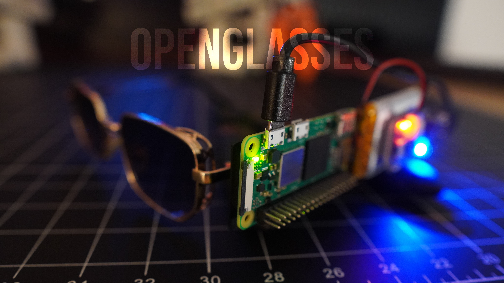

<!-- Banner -->

  

<h1 align="center">🕶️ OpenGlasses</h1>

  <em>
    A 3D-printable wearable that fuses AI, design, and human expression — turning ordinary glasses into extraordinary minds.
  </em>

  
  
  
  
  

---

## 🎥 The Vision

**OpenGlasses** isn’t just a gadget — it’s a cinematic leap into **AI-augmented fashion**.  
A blend of open-source intelligence, art, and personal identity — for creators who want to **see the future through their own lenses**.

> _“Technology meets individuality. Style meets singularity.”_

---

## ⚙️ Components

| Component | Purpose |
|------------|----------|
| 🧠 **Raspberry Pi Zero 2 W** | The microprocessor bridging hardware and AI software. Enables Wi-Fi, Bluetooth, and cloud LLM connectivity. |
| 🔋 **3.7 V Lithium Battery** | Compact, rechargeable power for true mobility — recommended 1000 mAh +. |
| ⚡ **Adafruit PowerBoost 1000** | Safely boosts 3.7 V → 5 V, powering the Pi reliably. |
| 🎙️ **Speaker / Microphone HAT** | Enables real-time voice conversation with your AI assistant. |

---

## 🚀 Getting Started

1. **Assemble** your printed frame and hardware.  
2. **Flash** Raspberry Pi OS onto the Pi Zero 2 W.  
3. **Wire** the PowerBoost 1000 between battery and Pi.  
4. **Mount** the Speaker/Mic HAT.  
5. **Configure** your ElevenLabs API and LLM endpoint for natural voice chat.  

---

## 🌌 Future of Wearables

We believe in **open-source augmentation** — technology built for **creativity, inclusivity, and freedom**.  
From modular vision systems to edge-AI processing, the OpenGlasses ecosystem grows with every maker who contributes.

  <strong>✨ Join the revolution. Build the future. Be the prototype. ✨</strong>

---

  

